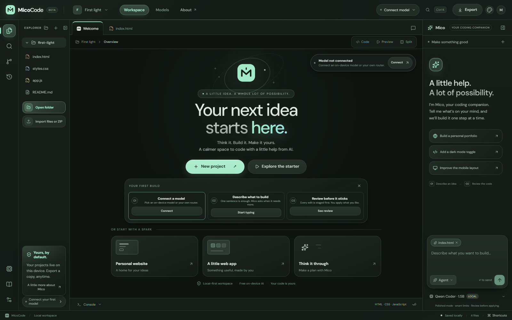
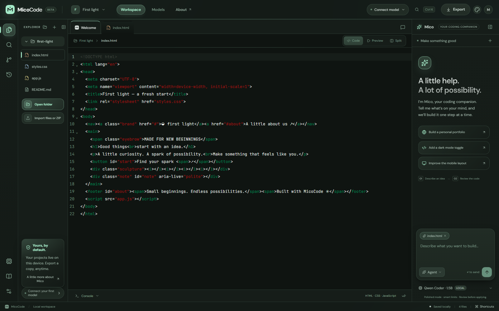
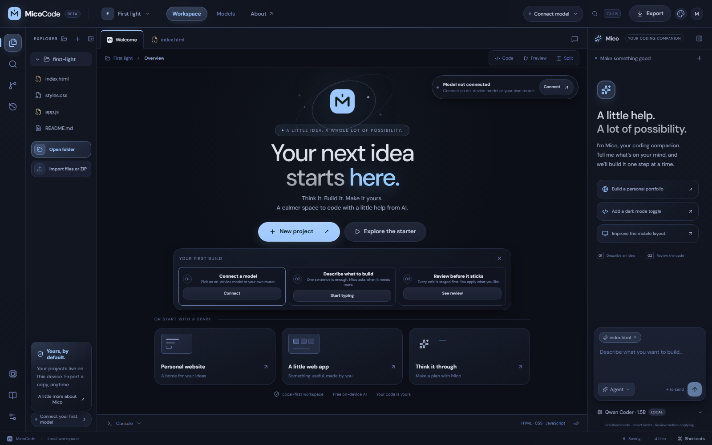
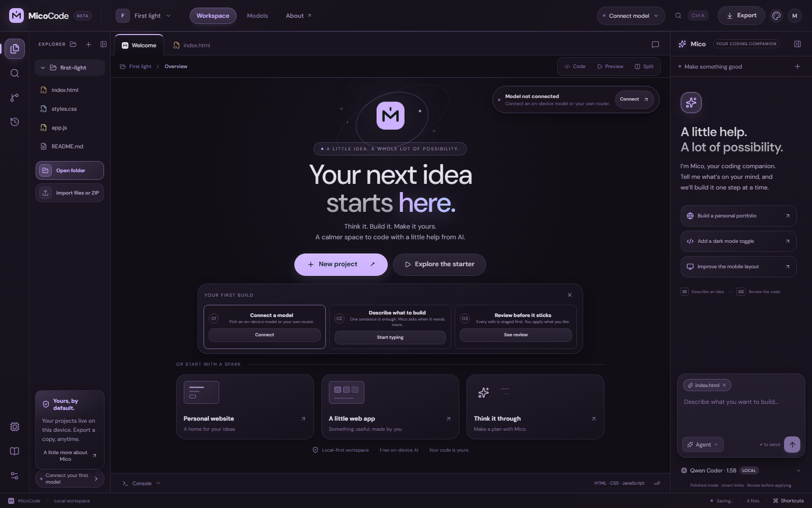
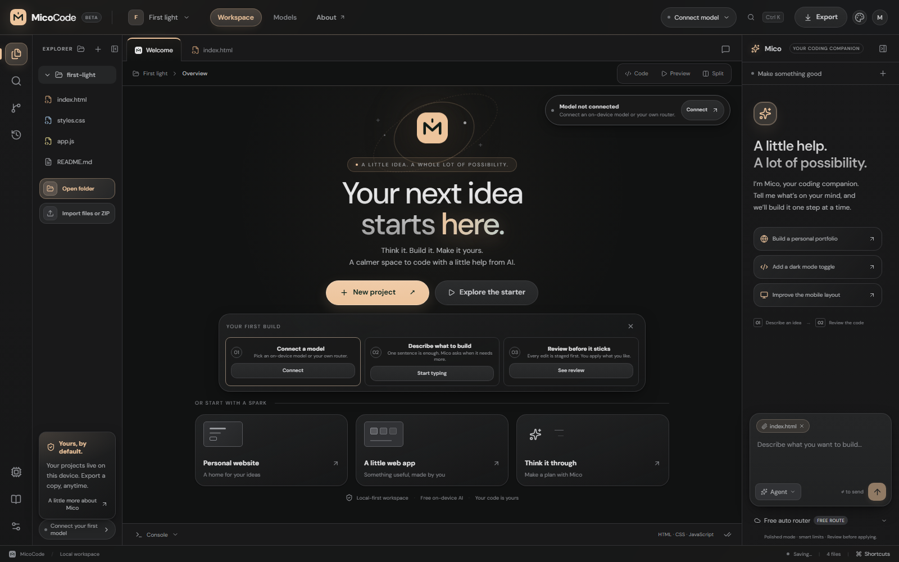
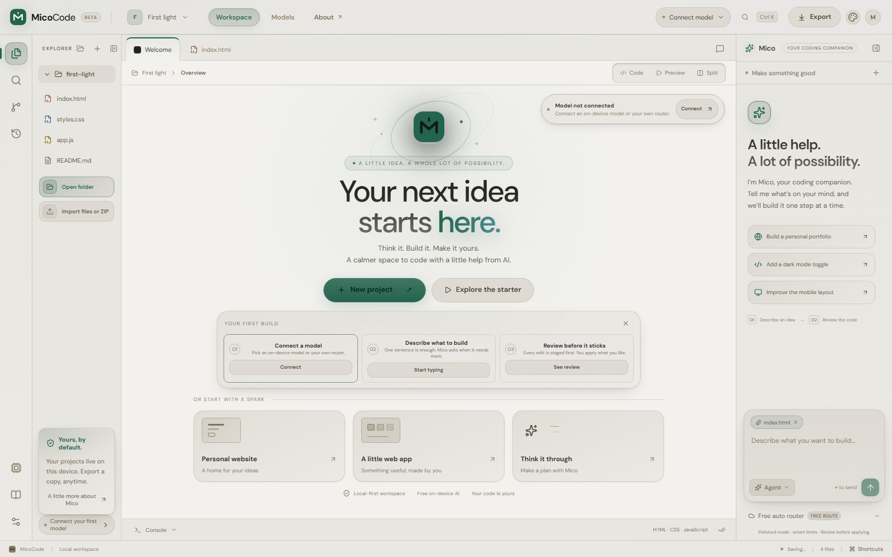

# MicoCode

Little ideas. Real things. A free agentic coding workspace for Windows and the browser.

[Website & downloads](https://micocode.vercel.app) · [Browser workspace](https://micocode.vercel.app/app/) · [Windows releases](https://github.com/ahpah-dev/MicoCode/releases)

## Screenshots





Five themes, one workspace:

| Midnight | Violet |
| --- | --- |
|  |  |
| **Graphite** | **Paper** |
|  |  |
## Windows app

Version 0.7.0 adds one-click FreeRide installation with automatic free-provider failover and direct NVIDIA NIM connections. It hides unreliable legacy OpenCode/Horde choices from new setup while keeping saved connections compatible.

On Windows, choose **Your routers → FreeRide → Set up**. MicoCode reuses a running gateway or installs a pinned private copy, reuses NVIDIA NIM/OpenRouter keys already saved in Connections, and saves new provider keys with Windows encryption. One provider key is enough; optional keys add failover choices. The managed FreeRide profile opts out of FreeRide telemetry.

Version 0.6.3 auto-detects a running local 9Router, loads its provider catalogue when your key is saved, and prompts for the key when needed. OpenCode quota cooldowns no longer block other 9Router providers; private and existing routers are clearly distinguished.

Version 0.6.2 isolates 9Router provider quotas so exhausting one provider no longer cools down unrelated providers. It also distinguishes MicoCode’s private 9Router from your existing router, and only lists OpenCode routes in managed mode when an active OpenCode connection is configured.

Version 0.6.1 fixes 9Router/OpenCode reasoning-model follow-up errors by echoing reasoning as protocol metadata without mistaking it for an agent action.

Version 0.6.0 is a major visual refresh: frosted-glass top bar, luminous accents, pill navigation, glass cards, animated hero, refined composer and dialogs, and thin themed scrollbars across all five themes.

Version 0.5.0 gives the explorer a visual refresh: the Open folder and Import buttons hug their content with icon chips instead of stretching to the sidebar edge, so they stay crisp at any width. The customization dropdowns keep their polished micro labels, softer corners, and tactile hover.

Version 0.4.9 lets the explorer Open folder and Import buttons stretch with the sidebar when you resize it, and gives the customization dropdowns a polished look with micro labels, softer corners, and a tactile hover and focus treatment.

Version 0.4.8 makes the console draggable like the side panels: drag its top edge, use the arrow keys, or double-click to reset the height — it persists across restarts. The Open folder and Import buttons in the explorer keep a tidy fixed size instead of stretching with the sidebar, and the chat box no longer frames every click with a green ring.

Version 0.4.6 gives the whole workspace a cohesive visual system: clearer navigation, more deliberate surfaces, calmer spacing, a redesigned first-run Welcome, richer chat and review states, and an editor that follows the active theme instead of showing CodeMirror’s stock slate. All five themes and mobile layout were checked in the running app.

Version 0.4.7 lets you open any folder on your computer as a live workspace. In the Windows app, choose Open folder and MicoCode loads its HTML, CSS, JavaScript, Markdown, and other text files, then writes reviewed edits straight back to that folder when you apply them — an atomic save per file, with dependency, secret, binary, and oversized files skipped for safety. Edits stay staged until you approve them, and the browser edition can import a read-only copy.

Version 0.4.5 finishes the customization pass: dropdowns across Settings and Connections are now dressed to match the workspace, with a theme-aware chevron, hover fill, focus ring, and popup list — and selects no longer force a dark popup inside the light Paper theme. The file explorer and the Mico panel are draggable by their inner edges, with sensible limits, keyboard resizing, double-click reset, and widths that persist across restarts. The message box grows as you type instead of sitting at a fixed height.

Version 0.4.4 makes the interface customizable and easier to use. Settings has a new Interface section: density (comfortable or compact), text size, editor text size, Mico panel side, reduce motion, and getting-started tips — all applied immediately and saved on this device. A "Your first build" checklist on Welcome walks through connecting a model, describing a task, and reviewing staged edits, one click per step. Panel layout persists across restarts, and pressing / anywhere jumps to the message box.

Version 0.4.3 gives every theme a proper status and elevation system. Warning, error, connection, and diff colors were hardcoded dark values, so the light Paper theme rendered them as dark boxes on a light panel and console error text fell to 1.58:1 contrast — effectively unreadable. Status colors now resolve from per-theme tokens and are verified to meet WCAG AA in all five themes; Paper's console errors are now 6.49:1. Overlays, focus rings, scrollbars, and text selection also follow the theme, with soft warm shadows on Paper instead of a black wash.

The 0.4.2 build fixes agent edits that failed with "The model reached its output limit before finishing." The managed local route now requests the same 4096-token answer window as every other connection instead of 1800, so writing a complete file is no longer truncated partway through. When a reply is genuinely cut off it is still never applied as a finished edit; the agent discards it, asks for a smaller step, and keeps working rather than ending the run. Two attempts are allowed before it stops with guidance, and staged work is preserved either way.

The 0.4.1 build repairs interrupted router replies, crashed managed processes, keyless Ollama setup, and catalogue results left over after switching providers. Reconnect repairs unhealthy private routers. Coding requests can use the selected route even when catalogue discovery is temporarily unavailable; provider authorization still applies. Compatible streaming and text-block replies are decoded without treating reasoning or tool calls as code.

Managed **9Router → Refresh model catalogue** discovers verified free OpenCode text models only when an active OpenCode provider is configured in that private router; it respects disabled models and client-key restrictions. A private MicoCode 9Router is separate from your existing 9Router account. Choose **Use existing 9Router** to load the provider models and combos enabled for your own API key. For a manually connected router, additional public OpenCode Free IDs are labelled as unchecked; your router still enforces its settings and authorization. Other provider and combo IDs returned by `/v1/models` are preserved.

Local action requests disable optional Ollama thinking per request, so supported models retain their full output budget for the JSON action answer. Ollama's model files and server settings remain unchanged. An explicit output-limit finish is still reported as an incomplete reply and never applied as a completed edit; the agent retries once with a smaller request instead of ending the run. [Ollama documents model-specific thinking controls](https://github.com/ollama/ollama/blob/main/docs/capabilities/thinking.mdx).

Local models receive the same bounded action schema in the browser and managed desktop gateway. Static checks catch stray text between explicit HTML head elements, and automatic polish retries focus on issues introduced by the current run. Changes remain staged for your review; these checks do not replace testing layout and interactions in Preview.

Existing saved OpenCode Zen profiles remain usable, but OpenCode Zen is no longer offered as a new connection choice. NVIDIA NIM provides direct model access with account credits; FreeRide adds local cross-provider failover.

Version 0.4.0 makes your own 9Router a first-class connection in the Windows app. Choose **Use existing** to connect to your running router and browse every model and combo it exposes, grouped by provider. Refresh the catalogue, save favorite models, and see reported pricing and context windows. Model choice is retained, the agent budgets from model context metadata, and restart no longer replaces your own router with MicoCode's private managed instance. If models are missing, check the key's permissions, enabled models per connection, and disabled list in the router dashboard. Provider quotas and billing remain controlled by those providers.

The 0.4.0 Windows downloads include the refreshed workspace design and searchable model picker. Install over the previous version. For your own 9Router, open **Models → Your routers → Use existing**, enter its API key, then connect. MicoCode reads `/v1/models`; an unrestricted 9Router API key shows all enabled provider models and combos.


Download the x64 installer or portable executable. The workspace, Electron, and a private Node runtime are included. No separate Node installation or terminal is needed. Windows 10/11 x64 is supported. This community release is unsigned; Windows may show a publisher warning.

Open **Models → Your routers**. Choose **Use existing** on 9Router to browse models from your connected providers, or choose **Set up** to install MicoCode's private local route. Managed setup downloads and verifies providers, configures routes for installed Ollama models, and shows progress with cancellation. No global npm installation or administrator access is required.

The default **local engine** uses Ollama. MicoCode reuses an existing installation and model, or downloads the official portable runtime and Qwen 3.5 9B automatically. A fresh setup may download a large runtime plus about 6.4 GB for the model. Local inference has no service quota or per-message fee; hardware, memory, context, and speed still matter.

Previously saved **community-engine** profiles remain supported for migration, but AI Horde is no longer offered for new connections. FreeRide is the recommended multi-provider failover gateway. MicoCode does not create upstream accounts or bypass provider limits.

**Ollama → Set up & connect** connects local models directly. When a managed connection is selected, MicoCode restores it when reopened, stops processes it started when closed, and leaves pre-existing Ollama servers running. A saved connection to your own 9Router remains selected across restarts. Installations stay in the application profile. The manager encrypts generated connection credentials with Windows encryption. Only the trusted workspace can invoke narrowly scoped native setup APIs; generated previews cannot access them.

## Appearance

Choose **Forest, Graphite, Midnight, Violet, or Paper** with the palette button or Settings. Workspace surfaces, controls, dialogs, and the editor follow the theme, which persists on the device. Paper is a light theme.

## Coding tools

- An agent loop reads files and ranges, searches, plans, stages exact edits/writes/deletes, and runs static resource and quality checks.
- Plan mode cannot change files. Existing-file rewrites require a full read; patches must match previously read text exactly once.
- Review diffs before applying. Applied changes create a checkpoint; up to 20 are retained. Stop preserves staged work.
- CodeMirror supplies autocomplete, folding, and syntax highlighting. The isolated HTML/CSS/JavaScript preview supports desktop/mobile views and console output.
- Create projects from templates, import text files or ZIPs, search, edit, and export applied files. Secret and dependency paths are excluded.

The console exposes named workspace commands, not an OS shell. npm builds, backend processes, Git remotes, and publishing generated projects require local development tools. Import supports 150 text files, 150 KB/file, and 2 MB total. Static checks do not replace runtime testing.

## Other free connections

The browser edition includes WebLLM, local Ollama, OpenRouter, direct NVIDIA NIM, and custom OpenAI-compatible endpoints. The Windows app can install FreeRide locally and route across NVIDIA NIM, OpenRouter, Groq, Hugging Face, Cerebras, Cloudflare Workers AI, and local Ollama with automatic failover. Existing OpenCode Zen and AI Horde profiles remain compatible but are hidden from new connection choices. Automatic provider installation is exclusive to Windows.

For manually configured routers, set the exact URL and its own key. Remote endpoints must use HTTPS; allow the exact MicoCode origin in CORS. Browser keys are isolated by endpoint and remain in the tab's session. The picker lists exposed models and marks prices when supplied by the router. Names containing “free” are not price proof. Downstream billing in manually configured routers remains the owner's responsibility. The dedicated OpenRouter relay enforces its zero-price policy independently.

OpenRouter requires your own key. Each request enforces zero maximum prompt/completion pricing, with free routes only for fallback. Provider quotas still apply. Smart limit handling honors retry/reset headers, paces requests, retries transient failures at most twice, and supports cancellation. Daily quota, budget, credit, and authentication errors stop. It does not remove limits or rotate credentials across providers.

Polished mode supplies responsive and accessibility guidance plus a final static review. Lean context preserves the original task and recent tool results, trims older results, reads ranges, and prefers exact edits. Small models benefit from smaller tasks; no quality or token-saving percentage is guaranteed.

## Storage and privacy

Projects, chats, proposed edits, and checkpoints live in IndexedDB on the device. Windows uses a persistent private profile; the website uses browser storage. Themes and preferences are saved locally. Browser API keys stay in session storage. The Windows manager encrypts its generated credentials; third-party provider configuration files remain in the private profile as required by those tools.

Local inference stays on the computer. Cloud inference shares prompts and requested file contents with the chosen endpoint and provider. Export backups regularly: deleting an application profile or clearing site data removes its workspace. Uninstalling MicoCode preserves its application data.

## Develop and build

Requires Node.js 22.13+. Desktop builds run on Windows x64.

```sh
npm ci
npm run dev
npm run typecheck
npm test
npm run build:web
npm run package:windows
```

Development runs at `http://127.0.0.1:5175`, workspace `/app/`. Windows builds appear in `release/`. Packaging downloads a pinned official Node 24 runtime, checks its SHA-256 digest, bundles web assets and local API handlers, and produces NSIS and portable executables. See `electron-builder.yml`; exact provider versions and archive checksums live in `desktop/artifacts.mjs`.

`npm run package:kit` retains the optional browser/Ollama relay kit, which requires separately installed Node and Ollama.

## Verification

`npm test` covers file protections, plan isolation, exact/partial edits, review, free model filtering, credential isolation, pacing, bounded retries, quota stops, cancellation, allowed native providers/engines, archive traversal/link rejection, and local server host/origin checks. TypeScript and production builds are checked too.

`node scripts/verify-desktop-providers.mjs build/provider-test` downloads official providers into an isolated test profile. Release checks installed 9Router, CLIProxyAPI, and LiteLLM, reused local Ollama, verified all four catalogues and idempotent reconnection, and received a real model response through 9Router's local route. Set `MICOCODE_VERIFY_GENERATION=1` for that generation probe.

A packaged executable smoke check verifies the actual renderer, native bridge, absence of renderer Node access, rejected arbitrary installer IDs, and local API responses. Browser checks cover theme selection/persistence, light/dark editors, dialogs, staged edits, apply/restore, preview scripts, console capture, and responsive layout. Browser model download and authenticated OpenRouter generation need suitable GPU hardware and an account key; they are not claimed as release-tested here.

## Credits

MicoCode uses React, CodeMirror, WebLLM, Electron, and Node.js. Managed providers are independent projects: [9Router](https://github.com/decolua/9router), [CLIProxyAPI](https://github.com/router-for-me/CLIProxyAPI), [LiteLLM](https://github.com/BerriAI/litellm), [FreeRide](https://github.com/Shaivpidadi/FreeRideV3), [uv](https://github.com/astral-sh/uv), and [Ollama](https://github.com/ollama/ollama). NVIDIA NIM is served by [NVIDIA Build](https://build.nvidia.com/models). Their licenses and service terms apply to their software and services.

MicoCode is independent software inspired by OpenCode and Antigravity, and is not affiliated with those products or the listed providers. MicoCode is MIT licensed.
